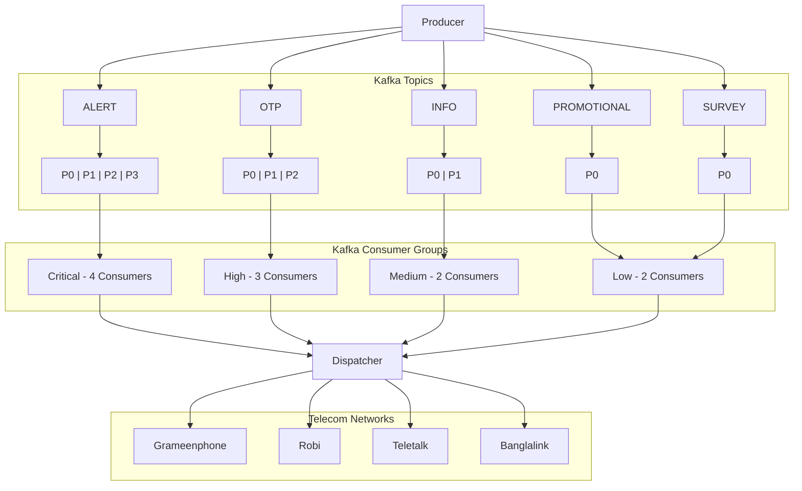

# sms-gateway

## Diagram



## Partition Routing Strategy

Each SMS uses the recipient's **normalized phone number** as the Kafka message key.

### How It Works

Kafka determines the target partition using Murmur2 hash:

```text
partition = abs(MurmurHash2(phoneNumber)) % total_partitions
```

| Topic           | Partitions | Routing                          |
|:----------------|:----------:|:---------------------------------|
| **ALERT**       |     4      | `hash % 4` &rarr; P0, P1, P2, P3 |
| **OTP**         |     3      | `hash % 3` &rarr; P0, P1, P2     |
| **INFO**        |     2      | `hash % 2` &rarr; P0, P1         |
| **PROMOTIONAL** |     1      | Always P0                        |
| **SURVEY**      |     1      | Always P0                        |

### Key Benefits

1. **Strict FIFO per Recipient**: All SMS for the same phone number always land on the same partition in chronological
   order.
2. **Uniform Load Balancing**: Different phone numbers distribute evenly across all partitions.

## Message Priority & Dispatch Processing

Each SMS message carries a priority level:

| Priority | Level | Default Topic | Description |
|:---|:---:|:---|:---|
| **CRITICAL** | 1 | `ALERT` | Urgent system & security alerts |
| **HIGH** | 2 | `OTP` | Time-sensitive one-time passwords |
| **MEDIUM** | 3 | `INFO` | Account notifications & transactional updates |
| **LOW** | 4 | `PROMOTIONAL`, `SURVEY` | Marketing campaigns & feedback requests |

### Dispatch Worker Processing

- **Priority Queue**: All consumer groups deliver messages into the Dispatcher's `PriorityBlockingQueue`.
- **Strict Precedence**: Worker threads immediately dequeue and process higher-priority messages first (`CRITICAL` &gt; `HIGH` &gt; `MEDIUM` &gt; `LOW`).
- **FIFO Fairness**: Messages sharing identical priority are processed in FIFO order based on their creation timestamp (`createdAt`).


